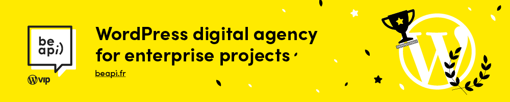

<a href="https://beapi.fr"></a>

# WP-CLI Site Duplicator

For multisite only. Introduces a WP-CLI command for duplicating a site on a WordPress multisite network.

Install and activate as a normal plugin. Then in the command line, from your site's root directory, run `wp help`. You should see `site duplicate` as a registered command, then you can continue.

## Requirements

* PHP >= 8.2
* WordPress >= 6.4 (multisite)

## Installation

```
wp plugin install https://github.com/BeAPI/wp-cli-site-duplicator-command/archive/refs/heads/master.zip --activate-network
```

## Usage

Duplicate your current site:

```
wp site duplicate <new-site-slug>
```

Duplicate a specific site on the network:

```
wp site duplicate <new-site-slug> --url=domain.tld/somesite
```

Make an existing or new user the administrator of the copy:

```
wp site duplicate <new-site-slug> admin@domain.tld --url=domain.tld/somesite
```

### Additional options

For a little extra output add `--verbose`

## Development

Quality tools need PHP 8.2+ and run on commit through GrumPHP:

```
composer install
composer cs      # PHPCS (WPCS 3 + PHPCompatibilityWP)
composer cbf     # PHPCS autofix
composer psalm   # Psalm, with WordPress and WP-CLI stubs
composer lint    # PHP syntax check
composer audit   # Known vulnerabilities in dependencies
```

End-to-end tests run on a local [DDEV](https://ddev.com) subdirectory multisite (WordPress core is downloaded into `tests/wordpress/`, which is not versioned).

```
ddev start
ddev e2e-test
```

`ddev e2e-test` rebuilds the network from scratch with `tests/e2e/seed.sh` (main site + `/child`, users, media, content, a custom table), then duplicates the child site and the main site and checks the copies with `tests/e2e/assert-duplicate.php`. The seed destroys all local data and can be run alone with `ddev e2e-seed`. The WordPress version is pinned by `WP_VERSION` in `tests/e2e/seed.sh`.

## Who ?

Created by [Be API](https://beapi.fr), the French WordPress leader agency since 2009. Based in Paris, we are more than 30 people and always [hiring](https://beapi.workable.com) some fun and talented guys. So we will be pleased to work with you.

This plugin is only maintained, which means we do not guarantee some free support. Consider reporting an [issue](#issues--features-request--proposal) and be patient.

If you really like what we do or want to thank us for our quick work, feel free to [donate](https://www.paypal.me/BeAPI) as much as you want / can, even 1€ is a great gift for buying coffee :)
